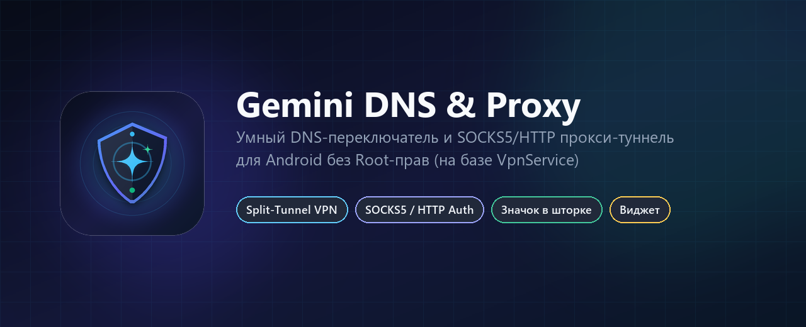
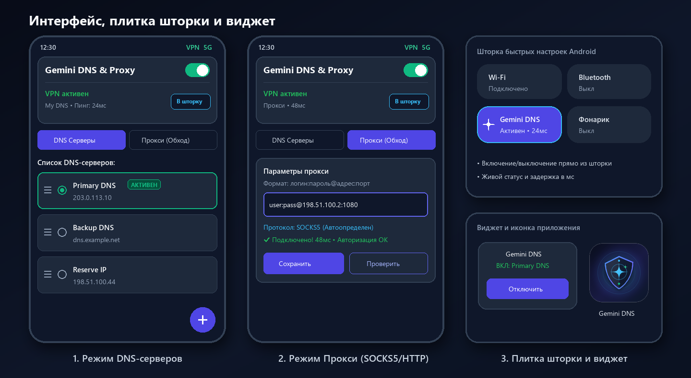

<p align="center">
  
</p>

<h1 align="center">🛡️ Gemini DNS & Proxy Switcher (Android)</h1>

<p align="center">
  <a href="https://github.com/Deus-hash/gemenium/releases/latest"></a>
  
  
  
  
</p>

---

## 🚀 Установка

Скачайте готовый APK-файл на смартфон и установите в один клик:

📥 **[Скачать последнюю версию GeminiDNS.apk](https://github.com/Deus-hash/gemenium/releases/latest/download/GeminiDNS.apk)**

---

## 🖼️ Интерфейс и быстрый доступ

<p align="center">
  
</p>

---

## ✨ Ключевые возможности

### 1. 🛡️ Режим Прокси (Обход ограничений)
* **Простой формат ввода**:
  Введите прокси в виде `логин:пароль@адрес:порт` (или `адрес:порт`, `socks5://...`, `http://...`).
* **Автоопределение протокола**:
  Приложение автоматически определяет, работает ли сервер по **SOCKS5** или **HTTP CONNECT**.
* **Встроенный локальный мост (`LocalProxyBridge`)**:
  Прозрачно пересылает трафик через ваш удаленный сервер с авторизацией `логин:пароль` без вскрытия шифрования (End-to-End TLS).
* **Умная диагностика (кнопка «Проверить»)**:
  Проверяет DNS с приоритетом IPv4 и резервным UDP-запросом, измеряет пинг, проверяет логин/пароль и доступность выхода в сеть, сообщая точную причину при сбое.

### 2. 🌐 Режим DNS-свитчера
* **Сплит-туннелирование (DNS-Only Tunnel)**:
  Через виртуальный туннель направляются **только DNS-запросы (порт 53)**. Весь основной трафик идет напрямую без просадки скорости (`allowBypass()`).
* **Поддержка любых серверов (IP и домены)**:
  Работает как с числовыми IPv4/IPv6-адресами, так и с доменными именами.
* **Smart Traffic Guard (Интеллектуальный Failover)**:
  Автоматически переключает сервер при длительной потере связи. При активном пользовательском трафике ложные переключения блокируются.
* **Локальный LRU-кэш (0 ms latency)** и **Drag-and-Drop сортировка** приоритета серверов.

### 3. ⚡ Значок в шторке и виджет на рабочий стол
* **Плитка быстрых настроек (`DnsTileService`)**:
  Включайте и отключайте туннель прямо из верхней шторки Android. На кнопке в шторке отображаются активный режим и текущий пинг. На Android 13+ добавить кнопку можно прямо из приложения нажатием **«В шторку»**.
* **Виджет рабочего стола (`DnsWidgetProvider`)**:
  Отображает актуальный статус и позволяет управлять туннелем с домашнего экрана.

---

## 🛠️ Стек технологий

<p align="left">
  
</p>

* **Язык**: Kotlin
* **Минимальная версия Android**: Android 8.0 (API 26+)
* **Сетевой уровень**: Android `VpnService`, сырые UDP-сокеты с `protect()`, `LocalProxyBridge` с RFC 1929 (SOCKS5) и Basic Auth (HTTP)
* **Асинхронность**: Coroutines & Kotlin StateFlow
* **Интеграция с системой**: `TileService` (Quick Settings Tile), `AppWidgetProvider`, `StatusBarManager`
* **UI**: Material Components, ViewBinding, ItemTouchHelper (Drag & Drop)
* **CI/CD**: GitHub Actions (автоматическая сборка APK при пуше)

---

## 💻 Сборка из исходников

```bash
git clone https://github.com/Deus-hash/gemenium.git
cd gemenium
./gradlew assembleDebug
```
Собранный файл появится в каталоге `app/build/outputs/apk/debug/app-debug.apk`.

---

## 📄 Лицензия

Распространяется под лицензией [MIT](LICENSE).
